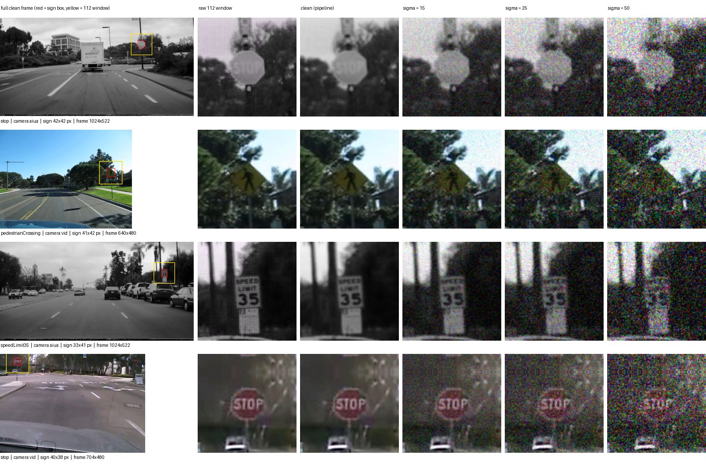

# Traffic Sign Recognition under Noise and Motion Blur

ECE 253 (Fall 2026) course project. We measure how much sensor noise and motion blur hurt
a traffic-sign classifier, and how much of that loss image restoration wins back, comparing
a classical method with a learning-based one for each artifact.

This repository holds the **shared pipeline**: the fixed sample list, the fixed classifier,
the degradations, and the evaluation function. Everything either team member reports must
come out of this pipeline so the numbers are comparable.

| Artifact | Classical method | Learning-based method |
|---|---|---|
| A: sensor noise | BM3D | DnCNN |
| B: motion blur | Wiener deconvolution | NAFNet |

## The task

```
clean full frame -> degrade (noise / blur) -> restore (none / classical / AI)
                 -> crop 112x112 window on the sign -> frozen classifier -> Top-1 accuracy
```

Degradation and restoration always act on the **full frame**; the window is cropped last.
The classifier is trained once on clean windows and never changes afterwards, so any change
in accuracy comes from the degradation and the restoration.



*Four test samples. Left to right: clean frame (red = sign box, yellow = classification
window), the raw window, the pipeline's clean window, then noise at sigma = 15, 25, 50.
Windows are shown upsampled 2x, as the classifier sees them.*

## The classification task (fixed)

- **Input**: a 112 x 112 window centred on the sign's bounding-box centre, reflect-padded
  at frame borders, **not** resized when cropped. Inside the model it is bilinearly
  upsampled 2x to 224 x 224.
- **Output**: one of 10 US sign classes.
- **Model**: ResNet-18 pretrained on ImageNet, final layer replaced. Trained on the clean
  training windows for 30 epochs (AdamW, lr 3e-4, batch 64, cosine schedule, rotation
  up to 10 degrees, scale 0.8-1.2), checkpoint chosen by validation accuracy.
- **Metric**: Top-1 accuracy. Clean validation accuracy is **98.0%**; this is the upper bound.
- **Checkpoint**: `data/classifier.pt`. Use this file. Do **not** retrain it: GPU training
  is not bit-reproducible, and two different classifiers make our results incomparable.

| Label | Class | Train | Val | Test |
|---|---|---|---|---|
| 0 | stop | 491 | 84 | 91 |
| 1 | pedestrianCrossing | 402 | 45 | 102 |
| 2 | signalAhead | 285 | 41 | 79 |
| 3 | addedLane | 126 | 41 | 20 |
| 4 | speedLimit35 | 105 | 33 | 19 |
| 5 | merge | 76 | 54 | 20 |
| 6 | stopAhead | 91 | 19 | 6 |
| 7 | speedLimit25 | 84 | 17 | 13 |
| 8 | laneEnds | 72 | 11 | 31 |
| 9 | yield | 44 | 8 | 26 |
| | **Total** | **1776** | **353** | **407** |
| | road-segment groups | 149 | 32 | 32 |

## The dataset (fixed)

Source: the [LISA Traffic Sign Dataset](https://cvrr.ucsd.edu/lisa-traffic-signs-dataset)
(7,855 annotations on 6,618 frames, 47 classes). The images are not in this repository;
download them as described under Setup.

`data/manifest.csv` **is** the processed dataset: one row per sample, 2,536 samples on
2,372 frames. It is built from the LISA annotations by `python -m tsr.prepare`, which is
deterministic (rebuilding gives a byte-identical file).

1. Keep signs whose bounding box is at least 32 x 32 px: 7,855 -> 3,633.
2. Drop the least sharp 10% (variance of the Laplacian inside the box): -> 3,269.
3. Keep the 10 most frequent classes: -> 2,536.
4. Split 70/15/15 **by road segment**, not by frame: tracks of the same video within 300
   frames of each other form one group and always land in the same split, so consecutive
   frames of one physical sign never straddle a split.

| Column | Meaning |
|---|---|
| `file` | frame path inside the LISA folder |
| `cls`, `label` | class name and integer label (0-9) |
| `x1, y1, x2, y2` | sign bounding box in the frame |
| `cx, cy` | window centre (bounding-box centre) |
| `camera` | `aiua` (1024x522, greyscale) or `vid` (704x480 / 640x480, colour) |
| `group` | road-segment id used for splitting and for confidence intervals |
| `split` | `train`, `val` or `test` |
| `sharpness` | variance of the Laplacian inside the box |

**Clean frames.** `tsr.data.load_clean_frame` returns the reference image. The `aiua`
frames (64% of the samples) are un-demosaiced greyscale mosaics with a 2x2 checkerboard
pattern; the loader removes it with a 3x3 bilinear kernel. `vid` frames are used as they are.

## Degradations

`tsr.degrade.degrade(frame, file, sigma=0, blur_len=0)` applies blur first, then noise.

- **Noise** (implemented): additive Gaussian, independent per colour channel,
  sigma in {15, 25, 50} on the 0-255 scale, rounded and clipped to [0, 255].
- **Motion blur** (to do, Artifact B): `tsr.degrade.motion_blur` is a stub. Lengths are
  {10, 20, 30} px; the angle of each frame is already fixed by `blur_angle(file)`.
- **Combined**: blur length 20, then noise sigma 25.

Every random draw is seeded by the frame's file name, so a frame always gets the same
noise field and blur angle on every machine. `numpy` is pinned for this reason.

## Setup

```bash
git clone https://github.com/incisors/Traffic-Sign-Image-Processing.git
cd Traffic-Sign-Image-Processing
python -m venv .venv
.venv/Scripts/activate            # Windows; on Linux/macOS: source .venv/bin/activate
pip install torch==2.14.1 torchvision==0.29.1 --index-url https://download.pytorch.org/whl/cu126
pip install -r requirements.txt
```

Download LISA (8.57 GB zip, no login needed) and extract it to
`data/LISA/signDatabasePublicFramesOnly/`:

```bash
mkdir -p data/LISA
curl -L -o data/LISA/lisa-traffic-sign.zip https://www.kaggle.com/api/v1/datasets/download/omkarnadkarni/lisa-traffic-sign
unzip -q data/LISA/lisa-traffic-sign.zip -d data/LISA/signDatabasePublicFramesOnly
```

The zip's MD5 is `7647e13a04c6db9210848f51d1d1c510`. After extraction
`data/LISA/signDatabasePublicFramesOnly/allAnnotations.csv` must exist. (The official UCSD
download link only resolves on the campus network.)

**Check your setup.** This must print the table below; if it does, your data, clean
frames, noise and classifier match:

```bash
python -m tsr.evaluate
```

```
val (353 samples), no restoration
  sigma   top-1    aiua     vid    PSNR    SSIM
      0  0.9802  0.9784  0.9836     inf  1.0000
     15  0.7819  0.7316  0.8770   24.90  0.5701
     25  0.4986  0.3723  0.7377   20.69  0.3993
     50  0.1501  0.0346  0.3689   15.27  0.2081
```

## Using the pipeline

A restoration method is a function that takes a degraded image and returns a restored one
(both `uint8`, H x W x 3):

```python
from tsr.evaluate import evaluate, group_ci

res = evaluate(restore=my_method, sigma=25, split="val")   # or blur_len=20
print(res["top1"], res["psnr"], res["ssim"], res["seconds"])
low, high = group_ci(res["correct"], "val")                # 95% interval
```

Rules we both follow:

- **Develop on `val`.** The test split is evaluated once, at the very end.
- **Report intervals with `group_ci`.** Frames of one road segment show the same sign and
  are not independent; with only 32 groups per split the intervals are wide (several
  points), so small differences between methods are not meaningful.
- **Compare methods on the same samples.** `group_ci(a["correct"].astype(int) -
  b["correct"].astype(int), "val")` gives the interval of the accuracy difference.

## Differences from the proposal

| Proposal | What the pipeline does | Why |
|---|---|---|
| 224 x 224 window, not resized | 112 x 112 window, upsampled 2x | The median sign is 43 px. Clean validation accuracy over 3 training seeds: 93.9% (92.4-95.8) with 224, 98.5% (98.0-98.9) with 112 upsampled |
| LISA frames used as they are | `aiua` checkerboard removed | The noise estimate on a "clean" `aiua` frame was sigma ~12; it is ~0.7 after removal |
| Split by video sequence | Split by road-segment group | There are only 17 videos and one holds 27% of the samples |
| 10-15 classes, 3,000-5,000 samples | 10 classes, 2,536 samples | Only 3,633 signs are at least 32 px; classes 11-15 appear on too few road segments to split |
| BM3D on the full frame | BM3D on the window plus a 64 px margin (noise ablation only) | 6.3 s -> 1.5 s per sign; identical predictions and PSNR on a 48-sample check. `evaluate` restores the full frame unless `roi_margin` is given |

The first two are switches in `tsr/config.py` (`WINDOW`, `UPSAMPLE`, `DEMOSAIC_AIUA`).
Changing either one means retraining the classifier and rerunning everything.

## Noise results so far (validation split, Top-1 %)

| Method | sigma 15 | sigma 25 | sigma 50 |
|---|---|---|---|
| No restoration | 78.2 | 49.9 | 15.0 |
| BM3D, oracle sigma | 96.9 | 94.3 | 84.7 |
| BM3D, estimated sigma | 96.6 | 93.5 | 82.2 |
| DnCNN-B, pretrained | 96.9 | 93.2 | 83.0 |
| DnCNN-B, fine-tuned on LISA | 97.2 | 95.2 | 85.0 |

Clean accuracy is 98.0%. Full numbers are in `results/noise_ablation.csv`. The
accuracy-tuned BM3D row of the ablation is not finished yet.

```bash
python -m tsr.noise_ablation dncnn_pretrained dncnn_finetuned   # GPU, about a minute
python -m tsr.noise_ablation bm3d_estimated                     # CPU, about 30 minutes
```

The pretrained DnCNN weights come from [cszn/KAIR](https://github.com/cszn/KAIR):

```bash
curl -L -o data/dncnn/dncnn_color_blind.pth https://github.com/cszn/KAIR/releases/download/v1.0/dncnn_color_blind.pth
```

## Repository layout

| Path | What it is |
|---|---|
| `tsr/config.py` | every shared setting |
| `tsr/prepare.py` | builds `data/manifest.csv` |
| `tsr/data.py` | clean frames, window cropping, noise-level estimate, manifest loader |
| `tsr/degrade.py` | noise, blur stub, per-frame seeding |
| `tsr/classifier.py` | the classifier (training script and loader) |
| `tsr/evaluate.py` | `evaluate` and `group_ci` |
| `tsr/denoise.py`, `tsr/dncnn_finetune.py`, `tsr/noise_ablation.py` | Artifact A |
| `data/manifest.csv`, `data/classifier.pt` | the fixed dataset and classifier |
| `data/dncnn/dncnn_finetuned.pth` | DnCNN fine-tuned on the LISA training split |
| `results/` | noise results on the validation split |

## Collected photographs

Photos we take ourselves are degraded and evaluated with the same code. To be usable they
must show one of the 10 classes above, and after downscaling the photo to a longer side of
about 1024 px the sign must be between 32 and 110 px across.

## Credits

- LISA Traffic Sign Dataset: A. Møgelmose, M. M. Trivedi, T. B. Moeslund, "Vision-based
  traffic sign detection and analysis for intelligent driver assistance systems:
  Perspectives and survey," IEEE Trans. ITS, 2012. Released under an academic license.
- BM3D: the `bm3d` Python package by Y. Mäkinen, L. Azzari, A. Foi.
- DnCNN weights: K. Zhang et al., via [cszn/KAIR](https://github.com/cszn/KAIR).
